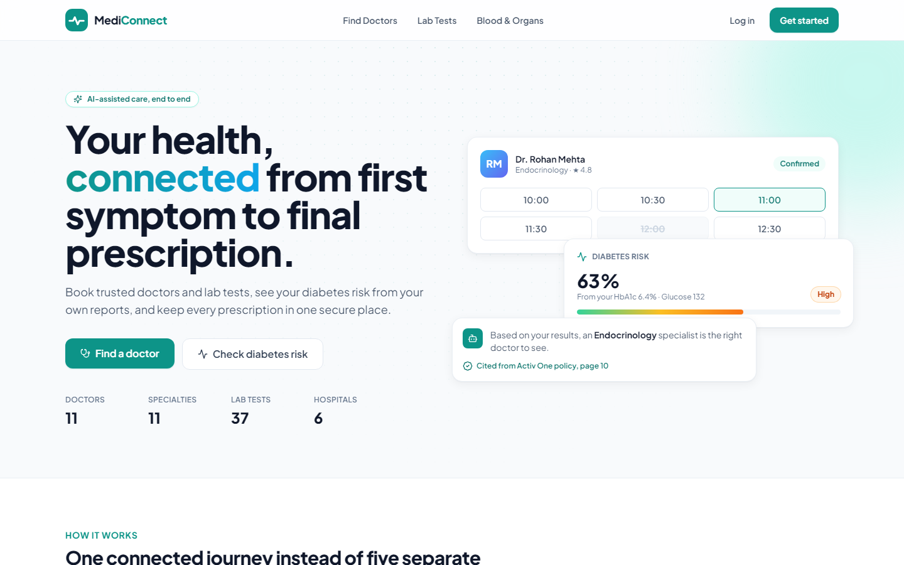
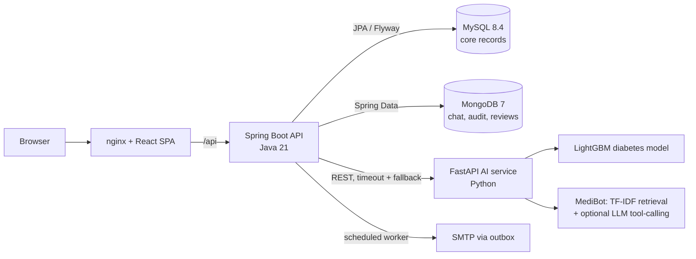
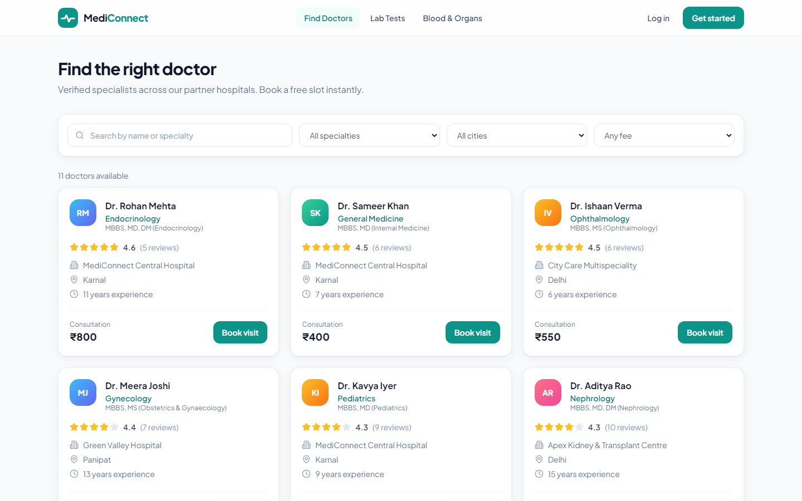
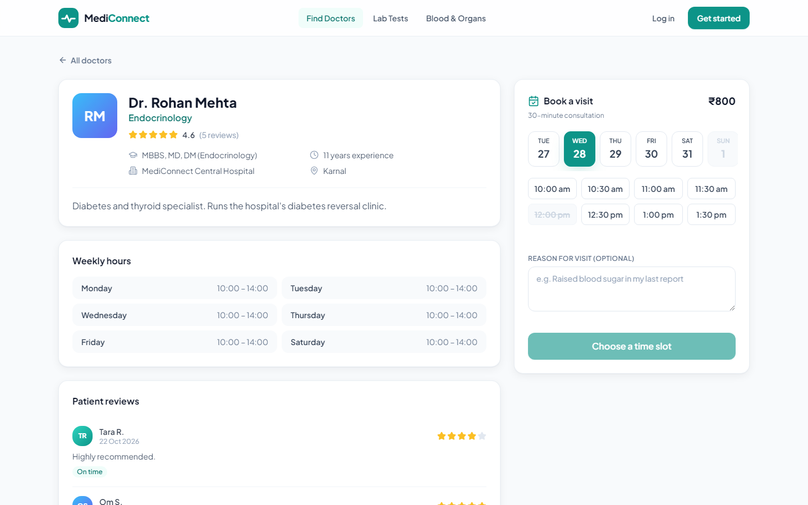
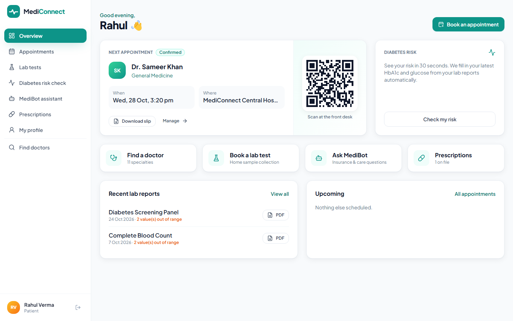
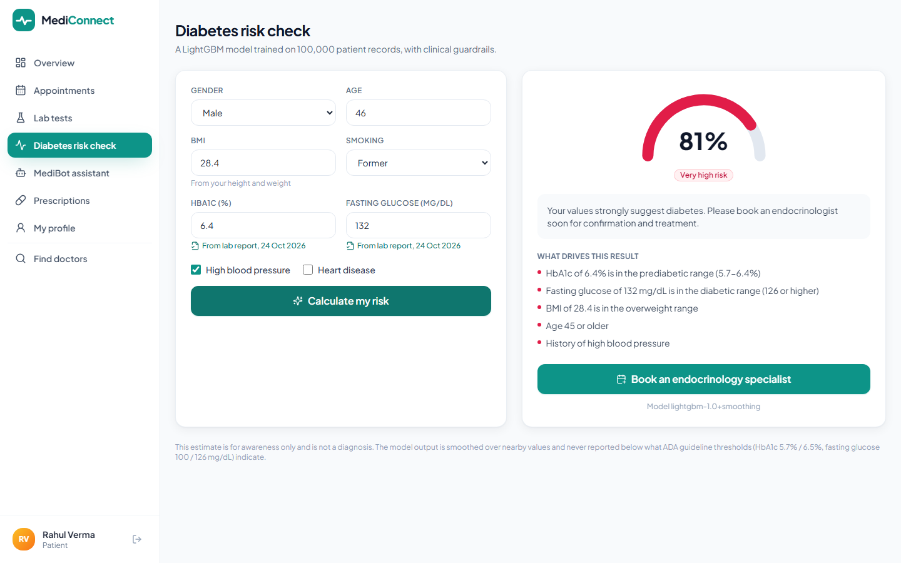
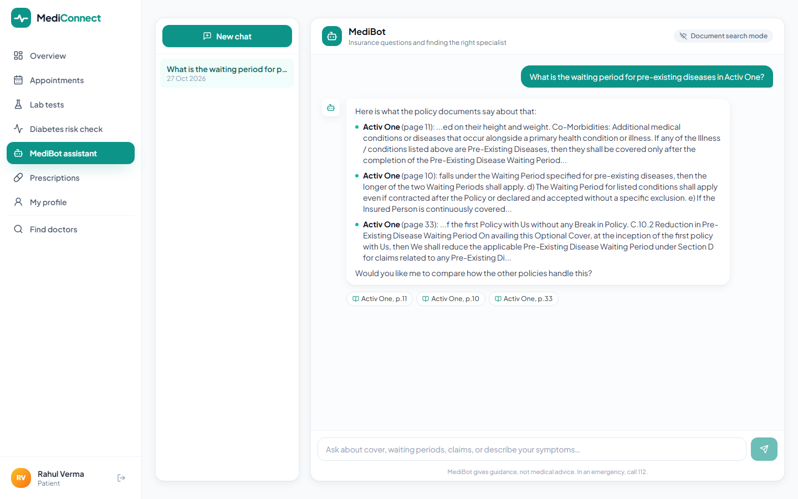
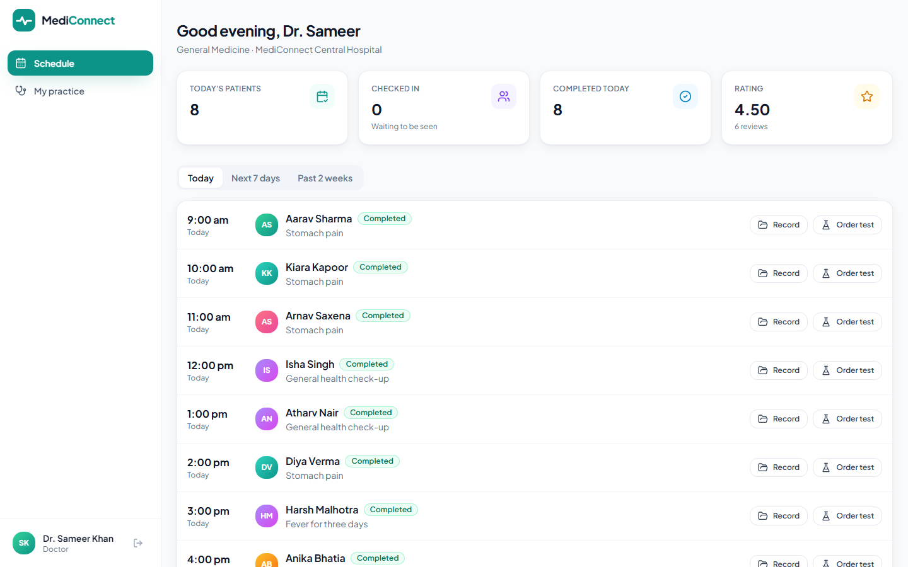
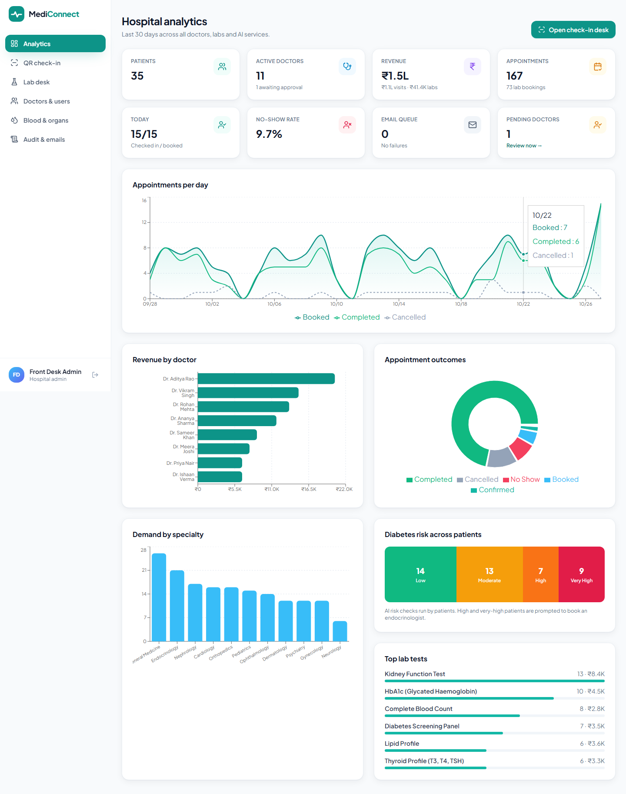
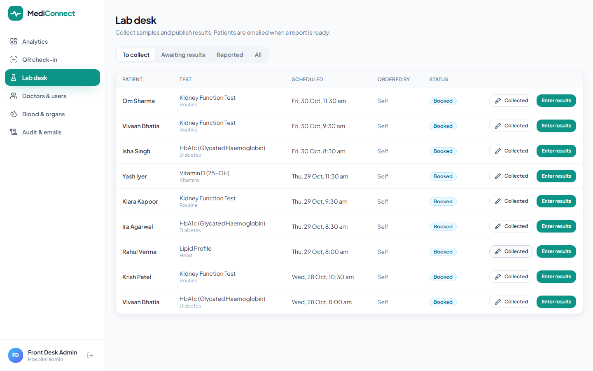

# MediConnect

**A full-stack healthcare platform: book doctors and lab tests, get an AI diabetes-risk estimate from your own lab reports, ask an insurance assistant that cites its sources, and check in with a QR code.**

       



## What it does

| Role | Highlights |
|---|---|
| **Patient** | Search verified doctors, book a free slot, reschedule or cancel, QR appointment slip (PDF), book lab tests and download reports, **AI diabetes risk check** prefilled from lab results, **MediBot** insurance assistant, prescriptions, reviews |
| **Doctor** | Daily schedule, confirm / no-show / complete, write digital prescriptions, order lab tests, view a patient's full record (audited), set weekly hours and slot length |
| **Admin** | Analytics dashboard, approve doctors, lab desk (collect samples, publish results), QR check-in scanner, blood and organ stock, audit trail and email outbox |

**The connected journey:** a patient books an HbA1c test → the lab publishes results → the risk check fills in those values and returns *High risk* → one click books an endocrinologist → a confirmation email goes out through the outbox, plus a reminder 24 hours before → the front desk scans the QR → the doctor writes a prescription → the patient downloads it and leaves a review → it all shows up in admin analytics.

## Architecture



| Layer | Technology |
|---|---|
| Frontend | React 18, Vite, Tailwind CSS, React Router, Recharts, html5-qrcode |
| Backend | Java 21, Spring Boot 3.3, Spring Security (JWT), Spring Data JPA / Hibernate, Spring Data MongoDB, Bean Validation, Flyway, OpenPDF, ZXing, springdoc OpenAPI |
| Data | MySQL 8.4 (relational core), MongoDB 7 (documents and logs) |
| AI | FastAPI, scikit-learn, LightGBM, pandas, pypdf, LangChain + OpenAI (optional) |
| DevOps | Docker, Docker Compose, GitHub Actions CI/CD, GitHub Container Registry |
| Testing | JUnit 5, AssertJ, Testcontainers, pytest, Vitest, Testing Library |

## Engineering decisions worth a look

**No double-booking, guaranteed by the database.** Booking checks availability in Java, but two requests can pass that check at the same moment. The real guarantee is a `UNIQUE (doctor_id, active_slot)` constraint, where `active_slot` is a generated column that becomes `NULL` when an appointment is cancelled, so cancelled slots can be booked again. The losing request gets a clear `409`. [`ApiFlowIT`](api/src/test/java/com/mediconnect/ApiFlowIT.java) fires **8 concurrent bookings at one slot against real MySQL** and asserts exactly one succeeds. Rescheduling cancels and rebooks in one transaction, so a failed move keeps the original appointment.

**Transactional outbox for email.** Confirmations, reminders and report notifications are written to `notification_outbox` in the same transaction as the booking, so an email exists if and only if the booking committed. A `@Scheduled` worker claims rows with an atomic `UPDATE … WHERE status='PENDING'` (safe with several API instances), sends them, and retries with exponential backoff (1, 2, 4, 8 minutes). Idempotency keys such as `reminder:{appointmentId}` mean the reminder job can run as often as it likes and each patient still gets one email.

**Polyglot persistence.** MySQL holds everything relational and transactional (users, appointments, labs, prescriptions, stock). MongoDB holds data that is document-shaped or append-only: MediBot conversations (messages embedded in the session), the audit log, delivery attempts and free-text reviews. Writing a review updates the doctor's rating in MySQL and saves the review in MongoDB inside one MySQL transaction, so a Mongo failure rolls the rating back.

**An honest ML integration.** The diabetes model is a LightGBM classifier (the best of XGBoost, CatBoost, LightGBM and Random Forest in [diabetes-prediction-ml](https://github.com/ayushcoder894/diabetes-prediction-ml)). Testing it showed the trees jump between the few HbA1c values in the training data (HbA1c 6.3% gave 93%, 6.5% gave 9%). The service therefore (1) averages predictions over a small grid of nearby inputs so risk rises smoothly with the lab values, and (2) never reports a band lower than the ADA guideline thresholds imply. Both behaviours are covered by tests.

**Security.** JWT in an `httpOnly`, `SameSite=Strict` cookie (no token in JavaScript), bcrypt passwords, role checks with `@PreAuthorize`, ownership checks on every record (another patient's appointment returns `404`, not `403`), account lockout after 5 failed logins, the same error message for unknown email and wrong password, generic error bodies with details only in server logs, and an audit entry every time a doctor opens a patient record.

**Graceful degradation.** The Java API calls the AI service with connect and read timeouts. If it is down, risk checks return a friendly `503` and the rest of the platform keeps working. MediBot works without an API key (document-search mode) and switches to LLM tool-calling when `OPENAI_API_KEY` is set.

## Quick start

Requirements: Docker Desktop.

```bash
git clone https://github.com/ayushcoder894/mediconnect.git
cd mediconnect
docker compose up --build
```

Open **http://localhost:3000**. The first start fills the database with a month of realistic activity.

| Demo account | Email | Password |
|---|---|---|
| Patient | `patient@mediconnect.dev` | `Demo@1234` |
| Doctor | `sameer.khan@mediconnect.dev` | `Demo@1234` |
| Admin | `admin@mediconnect.dev` | `Demo@1234` |

The login page has one-click buttons for all three. API docs (Swagger UI): **http://localhost:8080/swagger-ui.html**

Optional settings (LLM key, SMTP) go in `.env`; see [`.env.example`](.env.example).

### Running services individually

```bash
# MySQL + MongoDB only
docker compose up mysql mongo

# API (Java 21, Maven)
cd api && mvn spring-boot:run

# AI service
cd ai-service && python -m venv .venv && .venv/bin/pip install -r requirements-dev.txt
.venv/bin/uvicorn app.main:app --port 8000

# Client (proxies /api to :8080)
cd client && npm install && npm run dev
```

## Tests

```bash
cd api && mvn verify          # 20 unit tests + 6 integration tests on real MySQL/MongoDB (Testcontainers)
cd ai-service && pytest       # model behaviour, guardrails, retrieval, safety replies
cd client && npm test         # Vitest + Testing Library
```

CI runs all three suites and builds the Docker images on every push and pull request. After CI passes on `main`, CD publishes images to GitHub Container Registry and triggers deploy hooks when configured.

## Screenshots

| | |
|---|---|
|  |  |
|  |  |
|  |  |
|  |  |

## Project structure

```
mediconnect/
├── api/                Spring Boot REST API
│   └── src/main/java/com/mediconnect/
│       ├── auth/ security/ user/          JWT auth, roles, lockout
│       ├── doctor/ patient/ appointment/  scheduling and booking
│       ├── lab/ prescription/ pdf/        lab workflow, prescriptions, PDF + QR
│       ├── risk/ assistant/               AI service client, MediBot sessions
│       ├── review/ audit/ notification/   MongoDB documents, outbox worker
│       ├── hospital/ admin/ seed/         stock, analytics, demo data
│   └── src/main/resources/db/migration/   Flyway SQL
├── ai-service/         FastAPI: diabetes model + MediBot
├── client/             React SPA served by nginx
├── docs/               user stories, screenshots
├── docker-compose.yml
└── .github/workflows/  CI and CD
```

## Built from earlier projects

MediConnect brings together and rebuilds several of my earlier repositories:
[Healthcare-management-system](https://github.com/ayushcoder894/Healthcare-management-system) (the original PHP/MySQL version and its database design),
[diabetes-prediction-ml](https://github.com/ayushcoder894/diabetes-prediction-ml) (risk model),
[Health-Insurance-AI-Assistant](https://github.com/ayushcoder894/Health-Insurance-AI-Assistant-GenAI-FastAPI) (policy documents and tool-calling design behind MediBot), and
[genomics-website](https://github.com/ayushcoder894/genomics-website) (genetic test catalog and prices).

---

MediConnect is a portfolio project. AI outputs are guidance, not medical advice.
